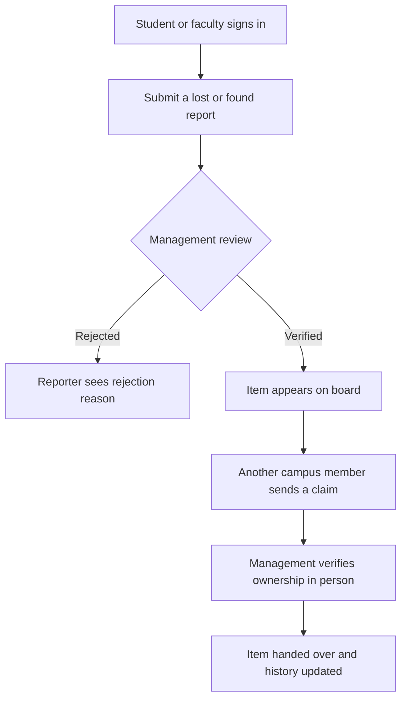

<div align="center">

# 🎒 Back2You

### Lost something? Let's bring it Back2You. 💙

**A campus-focused lost & found platform that makes reporting, verifying, claiming, and returning belongings simpler and more accountable.**


**[Features](#-features) · [How it works](#-how-it-works) · [Quick start](#-quick-start) · [Contributing](#-contributing)**

⭐ **If this project inspires you, consider starring the repository!**

</div>

---

## 💡 Why Back2You?

Lost belongings are a common campus problem. Traditional lost-and-found systems rely on notice boards, word of mouth, and manual record keeping. **Back2You** brings the process into one organized portal, with management approval before items appear publicly and an auditable handover process.

> **Our mission:** Help campus communities reconnect people with their belongings—without exposing private reporter details on the public board.

## ✨ Features

| Feature | What it does |
| --- | --- |
| 🎓 **Campus sign-in** | Student and faculty sign-in using a configured campus email domain and campus ID |
| 📝 **Lost & found reports** | Submit item details, location, date, category, and an optional photo |
| 🛡️ **Management verification** | Staff review reports before publishing them to the shared board |
| 🔎 **Verified item board** | Browse approved reports without revealing private reporter information |
| 🤝 **Item claims** | Send a claim request directly to management for review |
| 📦 **Verified handovers** | Management records returns and can reverse a mistaken handover |
| 🕒 **Activity history** | Keep an audit trail of important report and claim actions |
| 📊 **Management insights** | Weekly/monthly summaries, CSV exports, and uncollected-item tracking |
| 🔐 **Role-based access** | Separate student, faculty, and management permissions enforced by the backend |

## 🖼️ Screenshots

*Add real screenshots after running the app. Screenshots are one of the easiest ways to help visitors understand the project quickly.*

Suggested screenshots: **Sign-in**, **Lost & Found Board**, **Report an Item**, **Management Console**, and **Analytics Dashboard**.

<!-- Example after adding an image to docs/screenshots/:

-->

## 🔄 How it works



**Privacy by design:** Claims go to management, not directly to the person who posted the item. Only authorized management accounts can access private reporter details and management-only records.

## 🧰 Tech stack

| Layer | Technologies |
| --- | --- |
| Frontend | HTML5, CSS3, vanilla JavaScript |
| Backend | Node.js, Express 5 |
| Database | MongoDB, Mongoose |
| Authentication | JWT, HTTP-only cookies, bcryptjs for management access codes |
| Security | Helmet, express-rate-limit, server-side role checks |
| Utilities | CSV export, photo validation, activity history |

## 🚀 Quick start

### Prerequisites

- **Node.js 18+** and npm
- **MongoDB** running locally or a MongoDB Atlas connection string

### 1. Clone the repository

```bash
git clone https://github.com/YOUR_USERNAME/Back2You.git
cd Back2You
```

Replace `YOUR_USERNAME` with your GitHub username.

### 2. Install dependencies

```bash
npm install
```

### 3. Configure environment variables

Copy `.env.example` to `.env`:

**Windows PowerShell**

```powershell
Copy-Item .env.example .env
```

**macOS / Linux**

```bash
cp .env.example .env
```

Edit `.env`:

```dotenv
PORT=3000
NODE_ENV=development
MONGODB_URI=mongodb://127.0.0.1:27017/back2you
JWT_SECRET=replace_with_a_secure_random_secret_at_least_32_characters
CAMPUS_DOMAIN=sret.edu.in
```

Generate a secure secret with:

```bash
node -e "console.log(require('crypto').randomBytes(48).toString('hex'))"
```

Set `CAMPUS_DOMAIN` to your institution's official email domain if adapting the project to another campus.

### 4. Create a management account

```bash
npm run create-admin -- "Office Admin" "admin@sret.edu.in" "your-long-private-access-code"
```

Use an email belonging to your configured campus domain and an access code of at least 10 characters. **Never commit or share real access codes.**

### 5. Optionally add sample data

```bash
npm run seed
```

### 6. Launch the application

```bash
npm start
```

Open **http://localhost:3000** in your browser.

For development with Node's watch mode:

```bash
npm run dev
```

> **Note:** Run npm commands from the folder containing `package.json`. This project is served by Express; opening `index.html` directly does not replace a running backend and database.

## 🗂️ Project structure

```text
Back2You/
├── config/
│   └── db.js
├── middleware/
│   └── auth.js
├── models/
│   ├── User.js
│   ├── Report.js
│   ├── Claim.js
│   └── History.js
├── routes/
│   ├── auth.js
│   ├── reports.js
│   ├── claims.js
│   ├── history.js
│   └── admin.js
├── public/
│   ├── index.html
│   ├── style.css
│   └── script.js
├── scripts/
│   ├── createAdmin.js
│   └── seedSamples.js
├── utils/
├── .env.example
├── .gitignore
├── package.json
├── server.js
└── README.md
```

## 🔌 API overview

| Method | Endpoint | Purpose |
| --- | --- | --- |
| POST | `/api/auth/login` | Student/faculty sign-in |
| POST | `/api/auth/login/management` | Management sign-in |
| GET | `/api/auth/me` | Current session |
| POST | `/api/auth/logout` | Sign out |
| GET | `/api/reports/public` | Verified item board (authenticated) |
| GET | `/api/reports/mine` | Current user's reports |
| POST | `/api/reports` | Submit lost/found report |
| POST | `/api/claims` | Submit a claim |
| GET | `/api/history` | Role-filtered history |
| GET | `/api/admin/stats` | Management dashboard counts |
| GET | `/api/admin/summary` | Management reporting summary |

Management routes require a management account. Most other API endpoints require a valid session.

## 🔒 Security and deployment notes

Back2You includes role-based authorization, management access-code hashing, rate limits, HTTP-only session cookies, and security headers. However, **student/faculty sign-in currently checks campus email format and campus ID without proving email ownership**. This is **not strong identity verification**. Before a real campus deployment, add email OTP or institution SSO and test authentication thoroughly.

For production, also use HTTPS, set `NODE_ENV=production`, use a strong `JWT_SECRET`, secure the MongoDB deployment, and maintain backups. Do not commit `.env`, credentials, or `node_modules/`.

## 🛣️ Roadmap

Ideas for future improvements (not currently implemented):

- [ ] Email OTP or campus SSO authentication
- [ ] Smart lost/found item matching
- [ ] Notifications for possible matches and claim updates
- [ ] Mobile-first usability improvements
- [ ] Automated tests and CI checks
- [ ] Deployment guide and hosted demo

## 🤝 Contributing

Contributions, bug reports, design suggestions, and documentation improvements are welcome!

1. Fork this repository.
2. Create a branch: `git checkout -b feature/your-feature`.
3. Make and test your changes.
4. Commit: `git commit -m "Add your feature"`.
5. Push your branch and open a pull request.

For major changes, open an issue first so we can discuss the approach.

## 🌟 Support the project

If Back2You helps you learn full-stack development or inspires a campus project:

- ⭐ **Star the repository** to show support.
- 🍴 **Fork it** to explore or extend the code.
- 🐛 **Open an issue** to suggest an improvement or report a bug.
- 📣 **Share it** with students, developers, and campus communities.

**Built to make lost-and-found a little less frustrating. 💙**

---

<div align="center">

**Back2You — Because every lost item deserves a way home.**

</div>
